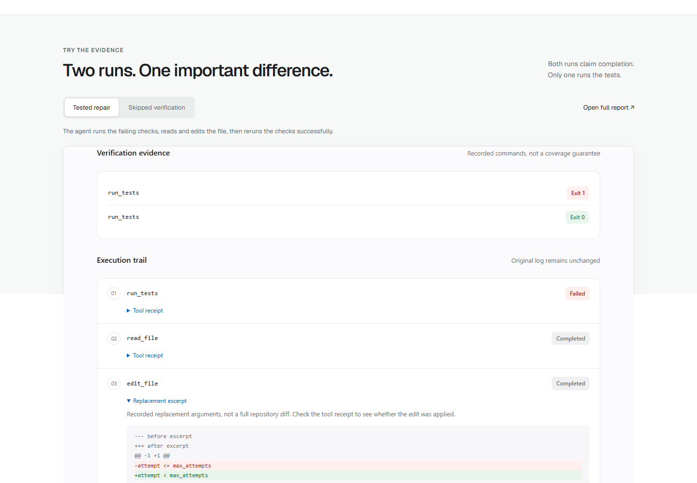

# DM-Code-Agent

**An inspectable coding agent. See what changed, why a run failed, and whether tests ran.**

[](https://github.com/hwfengcs/DM-Code-Agent/actions/workflows/ci.yml)
[](https://www.python.org/downloads/)
[](LICENSE)

**English** | [简体中文](README_ZH.md)

[**Open the interactive demo →**](https://hwfengcs.github.io/DM-Code-Agent/) · [Watch the walkthrough](docs/media/demo-walkthrough.gif) · [Get started](docs/getting-started.en.md)

[](docs/media/demo-preview.png)

DM-Code-Agent works in a local repository, calls file and command tools, and records an append-only session. Its CLI and browser console let you inspect the evidence behind the final answer.

- **Inspect the change.** Follow reads, edits, commands, and test output in one timeline. Export a self-contained HTML report for review.
- **Find the failure.** See tool failures, recovery attempts, and verification gaps—even when the agent says it finished.
- **Build on a readable agent.** Extend tools, providers, and lifecycle hooks without modifying the ReAct loop. Run deterministic tests and evals without an API key.

## Try it without an API key

Python 3.10+ is required. Install the v2.1.0 release wheel with the browser console included; Node.js is not needed:

```bash
pip install "dm-code-agent[web] @ https://github.com/hwfengcs/DM-Code-Agent/releases/download/v2.1.0/dm_code_agent-2.1.0-py3-none-any.whl"
dm-agent-demo --output demo-run
dm-agent-web --sessions-dir demo-run/sessions --read-only
```

Open the token-bearing local URL printed by the server. The demo creates two runs:

| Run | What to look for |
| --- | --- |
| `verified.jsonl` | A retry-boundary bug, a failing test, an edit, and a passing test run |
| `unverified.jsonl` | The same edit, followed by completion without running tests; the analyzer flags a verification gap |

The demo uses a **scripted client with the real agent, file tools, and Python unittest**. It makes no model calls, reads no user configuration or extensions, and writes only to a new or empty output directory. It demonstrates inspectability, not model performance.

Inspect or export it from the terminal:

```bash
dm-agent-trace analyze demo-run/sessions/unverified.jsonl
dm-agent-trace export demo-run/sessions/verified.jsonl --output report.html --include-content
```

Open `report.html` in a browser. Export defaults to a structural summary; `--include-content` adds redacted task, tool, and edit excerpts. Review real-session reports before sharing them: redaction cannot recognize every secret. The demo contains only bundled sample code.

## Use it in your repository

Set an API key for a supported provider (`DEEPSEEK_API_KEY`, `OPENAI_API_KEY`, `CLAUDE_API_KEY`, or `GEMINI_API_KEY`), then run from your target workspace:

```bash
dm-agent "Inspect this repository and identify the modules that most need tests" --provider deepseek --trace sessions/review.jsonl --show-steps
dm-agent-trace analyze sessions/review.jsonl
```

For interactive work, `dm-agent-web` opens the full conversation and audit console. [Configuration and first task →](docs/getting-started.en.md)

Using Xinference or another Chat Completions server? Follow the [local-model extension recipe](docs/local-models.en.md). It uses an explicit endpoint and keeps existing cloud-provider keys separate.

The agent can modify files and run commands with your local permissions. Use a Git checkout you can review; it is not a sandbox. `--trace` is redacted by default. Full model I/O capture, checkpoint recovery, and tool replay have separate, explicit controls—see [session privacy and replay](docs/tracing.md).

## What makes a run inspectable?

| Question | Evidence |
| --- | --- |
| What did the agent do? | Ordered tool calls, arguments, observations, and completion records |
| Did it recover? | Failure-stage analysis and subsequent actions |
| Did it verify the result? | Recorded validation actions and a verification-gap signal; these are not a proof of correctness |
| What changed between runs? | Trace comparison and per-task benchmark regressions |
| What happened to old context? | Compaction appends derived records; original session entries remain available |

The console and CLI use the same trace-analysis functions. A shareable HTML report works without a server and includes replacement excerpts when content export is enabled; it is not a complete Git diff. For local investigation, the trace tools also support explicit replay and checkpoint-based forks.

## Three things we learned by reading traces

**A real maintenance case:** [Twelve targeted checks passed. The repair still wasn't ready.](docs/case-studies/failure-classification/README.md) A live model repaired a historical defect in this repository, then hit two failing checks in the broader suite and exhausted its step budget. Inspect the [run report](https://hwfengcs.github.io/DM-Code-Agent/cases/failure-classification.html), exact patch, supplied tests, and independent offline reproduction.

These articles explain failures in this project's historical experiments, with small reproductions and links to the original evidence:

- [**More steps did not establish a better agent**](docs/articles/01-more-steps.en.md): 30-task pass counts rose from 22 to 24, but there were four regressions and estimated token use rose 30.6%.
- [**Why `from errors import NotFound` triggered replanning**](docs/articles/02-error-is-not-failure.en.md): source text was mistaken for tool status; 38 false failure classifications disappeared when the same traces were reclassified.
- [**Content-anchored edits reduced collateral damage**](docs/articles/03-content-anchored-edits.en.md): how unique text matching and edit feedback addressed a line-range failure mode—and exposed another bug.

The bundled benchmark has **30 hidden-test tasks** across coding and maintenance. Historical model runs are evidence about those configurations, not a leaderboard claim. The offline demo is not an evaluation. See [benchmark methodology](docs/benchmarks.md), [project status](docs/project-status.md), and the [original research logs](docs/research-log/).

## Build and verify

```bash
git clone https://github.com/hwfengcs/DM-Code-Agent.git
cd DM-Code-Agent
uv sync --frozen --extra dev
uv run --frozen dm-agent-demo --output demo-run
uv run --frozen python -m pytest
uv run --frozen python -m dm_agent.evals.cli --variant full --task direct_finish
```

Default tests and deterministic evals need no API key. The [contribution guide](CONTRIBUTING.md) and [agent instructions](AGENTS.md) contain the full checks. [Extension examples](examples/) show how to add behavior outside the kernel.

## Documentation

| Start here | Go deeper |
| --- | --- |
| [Getting started](docs/getting-started.en.md) · [中文首页](README_ZH.md) | [Architecture](docs/architecture.md) |
| [Local models / Xinference](docs/local-models.en.md) | [Provider extension example](examples/openai_compatible.py) |
| [CLI reference](docs/cli.md) · [Web console](docs/web.md) | [Extension API](docs/extensions.md) |
| [Sessions, privacy, and HTML export](docs/tracing.md) | [Benchmarks](docs/benchmarks.md) |
| [Articles in English and Chinese](docs/articles/README.md) | [Full documentation index](docs/README.md) |

The homepage, getting-started guide, local-model recipe, and standalone articles are available in both languages; deeper reference documentation is mostly in Chinese. If the project helps you understand a coding agent's behavior, a star helps other builders find it. Reproducible bug reports and small, focused contributions are welcome; see [CONTRIBUTING.md](CONTRIBUTING.md) and [SECURITY.md](SECURITY.md).

MIT licensed. See [LICENSE](LICENSE).
