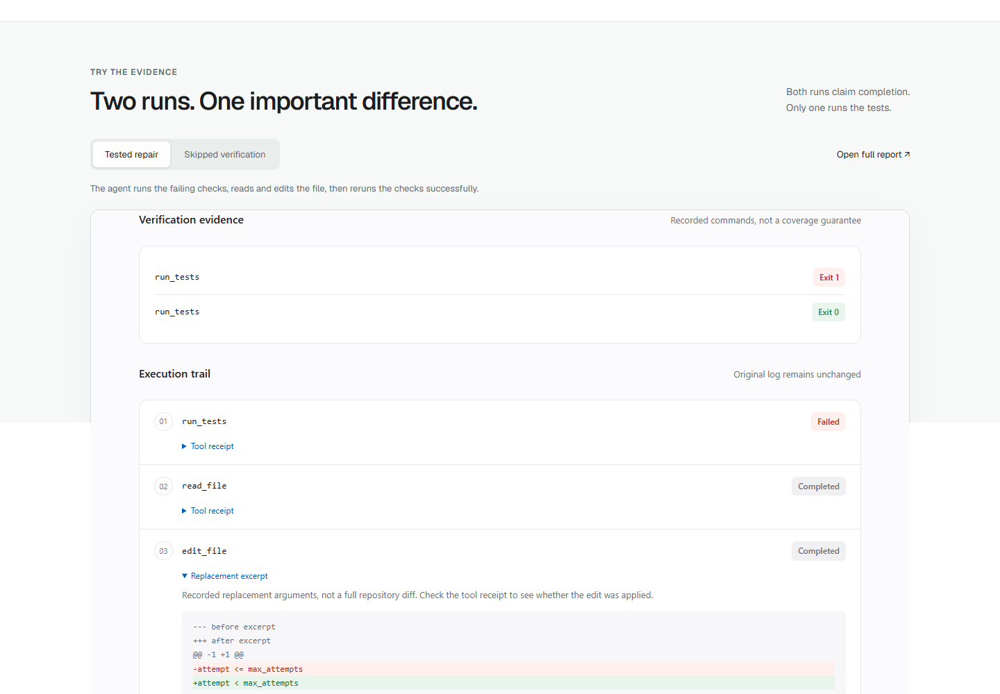

# DM-Code-Agent

**一个可以检查过程的编程 Agent：看清改了什么、为什么失败，以及有没有运行测试。**

[](https://github.com/hwfengcs/DM-Code-Agent/actions/workflows/ci.yml)
[](https://www.python.org/downloads/)
[](LICENSE)

[English](README.md) | **简体中文**

[**打开交互演示 →**](https://hwfengcs.github.io/DM-Code-Agent/) · [观看操作录屏](docs/media/demo-walkthrough.gif) · [快速开始](docs/getting-started.md)

[](docs/media/demo-preview.png)

DM-Code-Agent 在本地仓库中调用文件和命令工具，将过程记录为只追加的会话日志。你可以用 CLI 或浏览器控制台检查最终答复背后的证据。

- **检查修改。** 在同一条时间线上查看读取、编辑、命令和测试输出，导出独立 HTML 报告供人审查。
- **定位失败。** 看清工具失败、恢复尝试和验证缺口，包括 Agent 宣布完成但没有验证的情况。
- **读懂并扩展。** 不修改 ReAct 主循环也能添加工具、供应商和生命周期钩子；测试与确定性评估不需要 API key。

## 不用 API key，先看一次完整过程

需要 Python 3.10+。下面安装 v2.1.0 Release wheel，已包含浏览器控制台所需依赖，不需要 Node.js：

```bash
pip install "dm-code-agent[web] @ https://github.com/hwfengcs/DM-Code-Agent/releases/download/v2.1.0/dm_code_agent-2.1.0-py3-none-any.whl"
dm-agent-demo --output demo-run
dm-agent-web --sessions-dir demo-run/sessions --read-only
```

打开服务器打印的带 token 本地地址。演示生成两次运行：

| 运行 | 值得检查的内容 |
| --- | --- |
| `verified.jsonl` | 重试边界缺陷、失败测试、代码编辑、通过的测试 |
| `unverified.jsonl` | 完成同一修改后直接结束，没有运行测试；分析器标出验证缺口 |

演示使用**脚本化客户端驱动真实 Agent、文件工具和 Python unittest**。它不调用模型、不读取用户配置或扩展，只写入新建或空的输出目录。这是过程可检查性的演示，不代表模型能力。

也可以直接在终端检查和导出：

```bash
dm-agent-trace analyze demo-run/sessions/unverified.jsonl
dm-agent-trace export demo-run/sessions/verified.jsonl --output report.html --include-content
```

用浏览器打开 `report.html`。默认导出只有结构摘要；`--include-content` 才加入脱敏后的任务、工具输出和编辑片段。分享真实任务的报告前请先审阅：脱敏不能识别所有秘密。本演示只包含随项目提供的示例代码。

## 在自己的仓库中使用

配置一个供应商的 API key（`DEEPSEEK_API_KEY`、`OPENAI_API_KEY`、`CLAUDE_API_KEY` 或 `GEMINI_API_KEY`），在目标工作区执行：

```bash
dm-agent "分析当前项目结构，列出最适合优先测试的模块" --provider deepseek --trace sessions/review.jsonl --show-steps
dm-agent-trace analyze sessions/review.jsonl
```

运行 `dm-agent-web` 可进入完整的对话与审计控制台。[配置与第一个任务 →](docs/getting-started.md)

使用 Xinference 或其他 Chat Completions 服务时，见[本地模型扩展配方](docs/local-models.md)。扩展使用显式 endpoint，与现有云供应商密钥分开。

Agent 可以用你的本地权限修改文件和运行命令。建议在可审查的 Git 工作区使用；它不是沙箱。`--trace` 默认脱敏，完整模型 I/O、checkpoint 恢复和工具重放有各自的显式控制，见[会话隐私与重放](docs/tracing.md)。

## 能检查哪些证据？

| 问题 | 可以检查的证据 |
| --- | --- |
| Agent 做了什么？ | 按顺序记录的工具调用、参数、观察与完成记录 |
| 它恢复了吗？ | 失败阶段分析和后续动作 |
| 它验证了吗？ | 验证动作记录与验证缺口信号；这些不等于正确性证明 |
| 两次运行哪里不同？ | trace 行为对比和 benchmark 逐题回归 |
| 旧上下文去了哪里？ | 折叠只追加派生记录，原始会话条目仍然保留 |

控制台与 CLI 复用同一套 trace 分析函数。独立 HTML 报告无需服务器；开启内容导出时可以展示替换片段，它不是完整的 Git diff。本地排查还可以使用显式工具重放和基于 checkpoint 的分叉。

## 从 trace 中学到的三件事

**真实维护案例：**[12 项针对性检查通过了，修复仍然不能交付](docs/case-studies/failure-classification/README_ZH.md)。真实模型修复了本仓库的历史缺陷，但更大范围测试仍有 2 项失败，最终耗尽步数。案例提供[运行报告](https://hwfengcs.github.io/DM-Code-Agent/cases/failure-classification.html)、原样补丁、给定检查和独立离线复现。

三篇文章分别解释项目历史实验中的一种失败，包含最小复现和原始证据链接：

- [**更多步数为什么未必更成功**](docs/articles/01-more-steps.zh.md)：30 题的通过数从 22 到 24，但同时有 4 题回归，估算 token 增加 30.6%。
- [**为什么 `from errors import NotFound` 会触发重规划**](docs/articles/02-error-is-not-failure.zh.md)：源码正文曾被当作工具状态；同批 trace 重新分类后，38 次误报消失。
- [**内容锚定编辑如何减少相邻代码误伤**](docs/articles/03-content-anchored-edits.zh.md)：唯一文本匹配与编辑回显怎样解决行号区间问题，又怎样暴露了另一处缺陷。

项目自带 **30 道隐藏测试任务**，覆盖 coding 和 maintenance。历史模型运行只能支持对应配置下的结论，不是排行榜声明。离线演示也不是评测。完整口径见 [benchmark 文档](docs/benchmarks.md)、[项目现状](docs/project-status.md)和[原始研究日志](docs/research-log/)。

## 开发与验证

```bash
git clone https://github.com/hwfengcs/DM-Code-Agent.git
cd DM-Code-Agent
uv sync --frozen --extra dev
uv run --frozen dm-agent-demo --output demo-run
uv run --frozen python -m pytest
uv run --frozen python -m dm_agent.evals.cli --variant full --task direct_finish
```

默认测试与确定性评估不需要 API key。[贡献指南](CONTRIBUTING.md)和 [Agent 开发规则](AGENTS.md)列出了完整检查。[扩展示例](examples/)展示了如何在内核之外添加行为。

## 文档

| 从这里开始 | 进一步阅读 |
| --- | --- |
| [快速开始](docs/getting-started.md) · [English homepage](README.md) | [架构](docs/architecture.md) |
| [CLI 参考](docs/cli.md) · [Web 控制台](docs/web.md) | [扩展 API](docs/extensions.md) |
| [会话、隐私和 HTML 导出](docs/tracing.md) | [Benchmark](docs/benchmarks.md) |
| [中英文技术文章](docs/articles/README.md) | [完整文档目录](docs/README.md) |

如果这个项目帮你看懂了编程 Agent 的行为，欢迎点一个 Star，让更多开发者找到它。也欢迎可复现的问题报告和范围明确的小改动，见 [CONTRIBUTING.md](CONTRIBUTING.md) 与 [SECURITY.md](SECURITY.md)。

使用 MIT 许可证，见 [LICENSE](LICENSE)。
