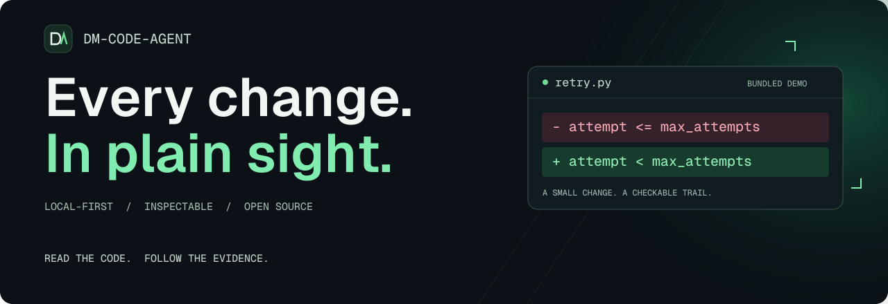
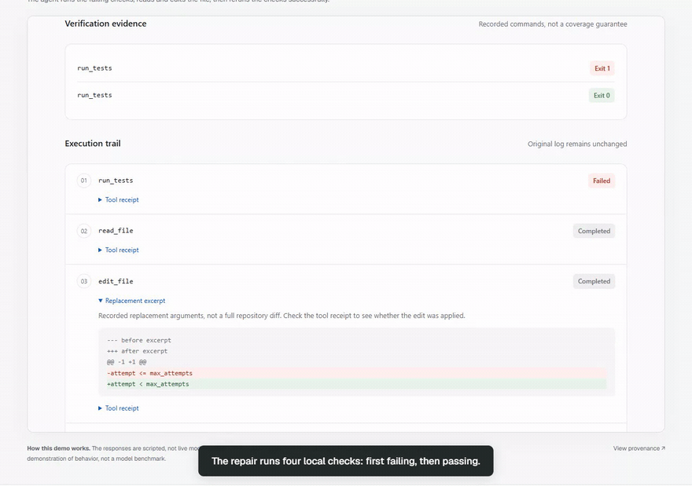

<div align="center">

<picture>
  <source media="(max-width: 640px)" srcset="docs/media/readme-hero-mobile.svg">
  
</picture>

<h1>DM-Code-Agent</h1>

<p><strong>一个可以检查过程的编程 Agent。</strong><br>看清改了什么、为什么失败，以及有没有运行测试。</p>

<p>
  <a href="https://github.com/hwfengcs/DM-Code-Agent/actions/workflows/ci.yml"></a>
  <a href="https://www.python.org/downloads/"></a>
  <a href="LICENSE"></a>
</p>

<p><a href="README.md">English</a> · <strong>简体中文</strong></p>

<p>
  <a href="https://hwfengcs.github.io/DM-Code-Agent/"><strong>交互演示</strong></a> &nbsp; / &nbsp;
  <a href="#不用-api-key先看一次完整过程"><strong>快速开始</strong></a> &nbsp; / &nbsp;
  <a href="docs/case-studies/failure-classification/README_ZH.md"><strong>真实维护案例</strong></a> &nbsp; / &nbsp;
  <a href="docs/README.md"><strong>文档</strong></a>
</p>

</div>

DM-Code-Agent 在本地仓库中工作，用只追加的会话日志保留每次运行的过程。
你可以在终端或浏览器中检查证据，再导出一份别人也能打开的报告。

- **看清修改。** 读取、编辑、命令和测试输出，串成一条执行记录。
- **发现缺口。** 检查失败、恢复尝试，以及宣布完成却没有验证的情况。
- **按需扩展。** 在可读的 Python Agent 周围添加工具、供应商和生命周期钩子。

## 看看证据怎么说

**两次运行，相同修改，只有一次真正运行了测试。**

<a href="https://hwfengcs.github.io/DM-Code-Agent/">
  <picture>
    <source media="(prefers-reduced-motion: reduce)" srcset="docs/media/demo-preview.png">
    
  </picture>
</a>

*真实浏览器录屏的 10 秒节选。助手决策来自脚本，文件修改和 unittest 确实执行，无需模型 key。
[观看完整 38 秒录屏](docs/media/demo-walkthrough.mp4)。*

## 不用 API key，先看一次完整过程

Python 3.10+，三条命令。Release wheel 已包含浏览器控制台，不需要 Node.js。

```bash
pip install "dm-code-agent[web] @ https://github.com/hwfengcs/DM-Code-Agent/releases/download/v2.1.1/dm_code_agent-2.1.1-py3-none-any.whl"
dm-agent-demo --output demo-run
dm-agent-web --sessions-dir demo-run/sessions --read-only
```

打开服务器打印的完整本地地址，选择 `verified.jsonl` 或 `unverified.jsonl` 检查差异。
输出路径必须是新目录或空目录。

<details>
<summary><strong>演示内容 · 终端检查 · HTML 导出</strong></summary>

| 运行 | 可以检查的证据 |
| --- | --- |
| `verified.jsonl` | 重试边界缺陷、失败测试、代码编辑和通过的检查 |
| `unverified.jsonl` | 相同修改后直接结束，分析器标出缺少测试的验证缺口 |

演示使用脚本化客户端驱动真实 Agent、文件工具和 Python unittest。
它不调用模型、不读取用户配置或扩展，只写入指定的新目录或空目录。
这是过程可检查性的演示，不代表模型能力。

```bash
dm-agent-trace analyze demo-run/sessions/unverified.jsonl
dm-agent-trace export demo-run/sessions/verified.jsonl --output report.html --include-content
```

用浏览器打开 `report.html`，不需要服务器。演示只包含随项目提供的示例代码。
真实会话默认导出结构摘要；`--include-content` 才加入脱敏后的任务、工具输出和编辑片段。
分享前请审阅，自动脱敏不能识别所有秘密。

</details>

## 在自己的仓库中使用

配置供应商密钥：`DEEPSEEK_API_KEY`、`OPENAI_API_KEY`、`CLAUDE_API_KEY` 或 `GEMINI_API_KEY`。
在可审查的 Git 工作区执行：

```bash
dm-agent "分析当前项目结构，列出最适合优先测试的模块" --provider deepseek --trace sessions/review.jsonl --show-steps
dm-agent-trace analyze sessions/review.jsonl
```

**[配置与第一个任务](docs/getting-started.md)** · **[Xinference / 本地模型配方](docs/local-models.md)** · **[Web 控制台](docs/web.md)**

Agent 可以用你的本地权限修改文件和运行命令，它不是沙箱。`--trace` 默认脱敏。
完整模型 I/O、checkpoint 和工具重放有各自的显式控制，见[会话隐私与重放](docs/tracing.md)。

## 能检查哪些证据？

| 你的问题 | 可以检查的证据 |
| --- | --- |
| **改了什么？** | 按顺序记录的工具调用、参数、观察与替换片段 |
| **哪里失败了？** | 失败阶段分析和恢复尝试 |
| **有没有验证？** | 验证动作记录与验证缺口信号 |
| **两次运行哪里不同？** | Trace 行为对比和 benchmark 逐题回归 |
| **旧上下文去哪了？** | 折叠只追加派生记录，原始条目仍然保留 |

CLI 与控制台使用同一套分析函数，独立 HTML 报告无需服务器。
记录到检查不等于证明正确，替换片段也不是完整 Git diff。
本地排查还支持显式工具重放和基于 checkpoint 的分叉。

## 真实修复，也保留不顺利的部分

> **12 项针对性检查通过了，更大范围的测试仍然失败。**
>
> 真实模型尝试修复本仓库的历史缺陷，但还有 2 项检查失败，最终耗尽步数。
> 这个未完成的结果保留了补丁、给定测试、token 用量和独立离线复现。

**[检查真实运行](https://hwfengcs.github.io/DM-Code-Agent/cases/failure-classification.html)** · **[阅读与复现案例](docs/case-studies/failure-classification/README_ZH.md)**

## 从失败中学到的事

每篇文章讲一个具体问题，提供原始证据、最小复现与结论边界。

| 故事 | 学到的事 |
| --- | --- |
| [**更多步数为什么未必更成功**](docs/articles/01-more-steps.zh.md) | 通过数从 22 到 24，同时有 4 题回归，估算 token 增加 30.6%。 |
| [**为什么源码里的 error 会触发重规划**](docs/articles/02-error-is-not-failure.zh.md) | `from errors import NotFound` 被误认成工具失败；同批 trace 重新分类后，38 次误报消失。 |
| [**先找到内容，再修改代码**](docs/articles/03-content-anchored-edits.zh.md) | 内容锚定编辑解决了行号区间误伤，又暴露了另一处缺陷。 |

自带 **30 道隐藏测试任务**，覆盖 coding 和 maintenance。历史运行只能支持对应配置下的结论，
不是排行榜声明，离线演示也不是评测。[评测口径](docs/benchmarks.md) · [项目现状](docs/project-status.md) · [研究日志](docs/research-log/)。

## 开发与验证

<details>
<summary><strong>从源码开发——测试与确定性评估不需要 API key</strong></summary>

```bash
git clone https://github.com/hwfengcs/DM-Code-Agent.git
cd DM-Code-Agent
uv sync --frozen --extra dev
uv run --frozen dm-agent-demo --output demo-run
uv run --frozen python -m pytest
uv run --frozen python -m dm_agent.evals.cli --variant full --task direct_finish
```

[贡献指南](CONTRIBUTING.md)和 [Agent 开发规则](AGENTS.md)列出了完整检查。
[扩展示例](examples/)展示了如何在内核之外添加行为。

</details>

## 找到下一步

| 从这里开始 | 进一步阅读 |
| --- | --- |
| [快速开始](docs/getting-started.md) · [English homepage](README.md) | [架构](docs/architecture.md) |
| [本地模型 / Xinference](docs/local-models.md) | [供应商扩展示例](examples/openai_compatible.py) |
| [CLI 参考](docs/cli.md) · [Web 控制台](docs/web.md) | [扩展 API](docs/extensions.md) |
| [会话、隐私和 HTML 导出](docs/tracing.md) | [Benchmark](docs/benchmarks.md) |
| [中英文技术文章](docs/articles/README.md) | [完整文档目录](docs/README.md) |

欢迎可复现的问题报告和范围明确的贡献。

<div align="center">

**如果这些证据帮到了你，欢迎点一个 Star。**

[参与贡献](CONTRIBUTING.md) · [安全问题](SECURITY.md) · [MIT 许可证](LICENSE)

</div>
